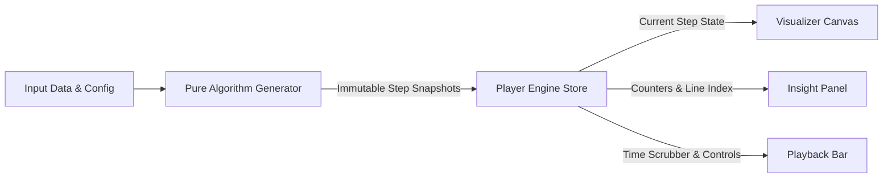

# DSA Explorer 🎓

> **Interactive Data Structures & Algorithms Learning Platform**  
> *A visual, pedagogical platform built as a college computer science mini-project.*

[](https://www.typescriptlang.org/)
[](https://react.dev/)
[](https://tailwindcss.com/)
[](https://vitest.dev/)
[](#)

---

## 🌟 Executive Overview

**DSA Explorer** is an interactive web platform designed to help students bridge the gap between abstract algorithmic theory and tangible execution behavior. Every algorithm is executed by a **pure generator engine** that produces an immutable timeline of state snapshots.

Students can scrub forward and backward in time, inspect live comparisons and memory allocations, manipulate graphs and trees directly on an interactive SVG canvas, test their intuition using a **"Predict the Next Step"** challenge, and toggle between **Beginner Mode** (rich conversational analogies and *"Why this matters"* callouts) and **Advanced Mode** (compact terminal opcodes, asymptotic $\Omega/\Theta/O$ mathematical bounds).

---

## 🏗️ Core Architecture & Design Principles



### 1. Pure Snapshot Generator Architecture (Zero External Algorithm Libraries)
All algorithms and data structures are implemented from first principles in clean, strongly-typed TypeScript. Algorithms do **not** manipulate the DOM or run asynchronous `sleep()` timers during execution. Instead, they operate as pure mathematical functions:
$$\text{generateSteps}: (\text{Input}) \longrightarrow \text{Array}<\text{Step}<\text{TState}, \text{TAuxiliary}>>$$

Each step encapsulates:
- `state`: Deep immutable clone of the data structure (array, tree node map, graph adjacency, or hash table slots).
- `auxiliaryState`: Active pointers (e.g., `low`, `mid`, `high`, `front`, `rear`, `head`, `tail`, `pivotIndex`).
- `counters`: Exact cumulative operation counts (`comparisons`, `swaps`, `iterations`, `accesses`).
- `codeLine`: 1-based index matching the displayed pseudocode tracker.
- `description`: Conversational step narration.
- `explanationDetail`: Pedagogical *"Why this matters"* note explaining the invariant reason for the transition.

### 2. Time-Travel & Deterministic Bi-directional Replay
Because every step is an immutable snapshot, navigating backwards in time (`prevStep()`, scrubbing the slider backwards, or pressing `←`) requires **zero inverse calculations or undo stacks**. Stepping backward simply loads snapshot $k - 1$, restoring the exact historical state, counters, pointer positions, and highlights.

### 3. Module Switch Clean Reset Invariant
Switching between learning modules (e.g. from Sorting to Trees) calls `usePlayerStore.getState().clear()`, synchronously resetting the playback timeline, counters, narration, and pseudocode. When the target module mounts, it generates its own fresh initial state, guaranteeing **zero residual counters or leftover text across modules**.

---

## 📚 Interactive Learning Modules

### 1. Sorting Algorithms
- **Algorithms**: Bubble Sort, Selection Sort, Insertion Sort, Merge Sort (recursive sub-arrays and auxiliary buffer), Quick Sort (Lomuto partitioning with pivot selection), and Heap Sort (synchronized array bars + live binary max-heap representation).
- **Comparison Mode**: Compare two algorithms side-by-side on the exact same randomized input.
- **Operations vs Input Size Chart**: Live theoretical $O(N \log N)$ vs $O(N^2)$ curves compared against actual comparisons and swaps.

### 2. Searching Algorithms
- **Linear Search**: Sequential scan with match / miss outcome banners.
- **Binary Search**: Dynamic `Low`, `Mid`, and `High` boundary pointers. Halved search ranges are greyed out to highlight the logarithmic space elimination. Includes unsorted array validation with an immediate *"Sort First"* quick-fix button.

### 3. Stacks, Queues & Ring Buffers
- **Stack**: Push, Pop, and Peek with visual vertical stack container, top-pointer animations, and capacity overflow/underflow alerts.
- **Queue**: First-In, First-Out (FIFO) visual line with `front` and `rear` indicators.
- **Circular Queue (Ring Buffer)**: Modular arithmetic pointer advancement `(index + 1) % capacity` demonstrating circular wrap-around and memory recycling.
- **Balanced Parentheses Checker**: Step-by-step bracket stack parsing `()`, `[]`, `{}` with mismatched type and unclosed delimiter diagnostics.

### 4. Binary Trees & AVL Rotations
- **Dynamic Tree Canvas**: Auto-centering SVG tree layout engine with collision-free in-order node positioning supporting up to 15+ nodes without branch overlapping.
- **Binary Search Tree (BST)**: Search, Insert, and full **3-Case Delete** (Leaf, 1 Child, and 2 Children with in-order successor copy and explicit narration). Duplicate keys are strictly rejected with set invariant notifications.
- **4 Tree Traversals**: In-order (sorted BST output ribbon), Pre-order, Post-order, and Level-order (BFS queue) live sequence accumulation.
- **AVL Tree Self-Balancing**: Real-time height tags (`h:X`) and balance factor badges (`BF = h_L - h_R`). Detects unbalanced nodes and animates **LL, RR, LR, and RL single & double rotations** with causal explanations.

### 5. Interactive Graphs & Pathfinding
- **Interactive SVG Editor**: 
  - `Select / Move`: Drag vertices across canvas to reposition.
  - `Add Node`: Click anywhere on the canvas to place a vertex.
  - `Connect Edge`: Click source then target vertex (or Shift+Drag between nodes).
  - Inline weight editor and raw Edge List modal sync.
  - Toggle between Directed/Undirected and Weighted/Unweighted modes.
- **Breadth-First Search (BFS)**: Radial level-by-level frontier exploration via FIFO queue.
- **Depth-First Search (DFS)**: Recursive branch exploration with alphabetical neighbor tie-breaking.
- **Dijkstra's Algorithm**: Greedy single-source shortest path calculation with live distance table relaxation, settled node sets, and highlighted optimal path tracing.

### 6. Hash Tables & Collision Resolution
- **Hash Functions**: Division Method ($k \bmod m$), Multiplication Method ($\lfloor m \times ((k \times A) \bmod 1) \rfloor$), and Polynomial String Hash ($\sum c_i \cdot 31^{n-1-i} \bmod m$). Narration explicitly explains calculation derivation (ASCII sum vs base-31).
- **Collision Strategies**:
  - *Separate Chaining*: Dynamically growing bucket linked lists.
  - *Linear Probing*: Open addressing probing $(h + i) \bmod m$. Soft-deleted keys are marked as **Tombstones (`DEL ⚰️`)** so searches continue past them unbroken, and inserts reuse earliest tombstones after confirming absence.
  - *Quadratic Probing*: Open addressing probing $(h + i^2) \bmod m$ with cycle failure detection.
- **Dynamic Rehash**: Double capacity ($m \to 2m$) or rehash to next prime above $2m$ (for quadratic probing) with live load factor gauge ($\alpha = n/m$) and automatic tombstone cleanup.

### 7. Big-O Complexity Cheat Sheet
- Searchable and filterable master matrix covering time complexities (Best, Average, Worst), space complexity, stability, and invariant notes across all 20+ operations. Includes one-click *"Visualize"* buttons that immediately launch any algorithm.

---

## ♿ Accessibility, UI/UX & Keyboard Navigation

- **Visible Focus Outlines (WCAG 2.4.7)**: High-contrast `:focus-visible` blue outline (`2px solid #3b82f6`) across all interactive controls.
- **Reduced Motion Support (WCAG 2.3.3)**: `@media (prefers-reduced-motion: reduce)` zeroes out CSS animation/transition durations; celebration confetti respects system preference and includes a manual on/off toggle.
- **Color-Blind Safe Visual Cues**: Visualizers pair color with shape badges (`■`, `●`, `▲`, `✓`, `—`) or alphanumeric markers (`BF`, `h:`, `DEL`, `1st`, `S`, `T`, `★`).
- **Keyboard Shortcuts**:
  - `Space`: Play / Pause playback
  - `→` / `↓`: Step forward one operation
  - `←` / `↑`: Step backward (time-travel to previous snapshot)
  - `R`: Reset to the beginning
- **Light & Dark Mode**: High-contrast theme switcher with tailored palette support.
- **Responsive Layout**: Designed for desktop and tablet screens (< 1024px) with flexible canvas stacking.
- **First-Visit Guided Tour**: 5-step skippable interactive onboarding.
- **"?" Algorithm Guide & Real-World Analogies**: Contextual explainers on every module.
- **"Predict the Next Step" Challenge**: Interactive quiz testing student intuition on upcoming operations.

---

## 🚀 Getting Started

### Prerequisites
- Node.js (v18 or higher recommended)
- npm or yarn

### Installation & Local Development

```bash
# Clone the repository
git clone https://github.com/your-username/dsa-explorer.git

# Navigate to project folder
cd "DSA Explorer"

# Install dependencies
npm install

# Start local development server
npm run dev
```

Open `http://localhost:5173/` in your browser.

---

## 🧪 Testing & Verification

The test suite runs on [Vitest](https://vitest.dev/) and verifies mathematical correctness, algorithmic invariants, edge cases, and snapshot immutability across 145+ automated tests.

```bash
# Run all unit and integration tests
npm run test

# Run tests in watch mode
npx vitest

# Build for production
npm run build
```

### Verified Test Suites

| Test Suite | Scope & Invariants Tested | Tests |
| :--- | :--- | :---: |
| `tests/sorting.test.ts` | 6 algorithms vs `Array.sort` on 200+ random arrays, empty, single, reversed, duplicate arrays; assert 0 input mutations | 54 |
| `tests/searching.test.ts` | Binary search vs `indexOf` on 200+ random sorted arrays, duplicates, not found, unsorted warnings | 12 |
| `tests/stack-queue.test.ts` | 200+ random push/pop/enqueue/dequeue sequences vs JS array model, ring buffer wrap-around, parentheses validator | 19 |
| `tests/trees.test.ts` | BST 3-case delete, in-order sort invariant, 4 traversals vs reference, AVL $[-1, 0, 1]$ balance across 200+ trees | 15 |
| `tests/graphs.test.ts` | BFS/DFS traversals, Dijkstra shortest path valid path and distance sum equality across 200+ random graphs | 14 |
| `tests/hashing.test.ts` | Polynomial and division math derivation, 200+ random ops vs `Map`, tombstone reuse, quadratic failure, next prime resize | 12 |
| `tests/player-engine.test.ts` | Step advancement, jump slider, speed scaling, bi-directional replay state restoration | 8 |
| `tests/integration.test.ts` | Smoke test rendering every page without crashing, module switch state purging & clean reset | 12 |
| **Total Automated Tests** | **All 8 suites passing** | **146** |

---

## 🛠️ Project Structure

```text
DSA Explorer/
├── src/
│   ├── algorithms/
│   │   ├── sorting/          # Bubble, Selection, Insertion, Merge, Quick, Heap
│   │   ├── searching/        # Linear, Binary Search
│   │   ├── stackQueue/       # Stack, Queue, Circular Ring Buffer, Parentheses
│   │   ├── trees/            # BST, AVL Rotations, 4 Traversals
│   │   ├── graphs/           # BFS, DFS, Dijkstra, Edge List Parser
│   │   └── hashing/          # Division, Multiplicative, String Poly, Chaining, Probing
│   ├── components/
│   │   ├── common/           # Modal, HelpModal, ColorLegend, QuizModal, Badge, Tooltip
│   │   ├── insights/         # NarrationBox, CountersCard, PseudocodeViewer, ComplexityCard
│   │   ├── layout/           # Header, Sidebar, DashboardLayout, BottomPlayerBar
│   │   ├── tour/             # GuidedTour (5-step skippable onboarding)
│   │   └── visualizers/      # ArrayBars, TreeVisualizer, GraphVisualizer, HashVisualizer
│   ├── engine/               # Pure Player timeline engine, usePlayerStore, keyboardShortcuts
│   ├── pages/                # LandingPage, SortingPage, SearchingPage, TreesPage, GraphsPage, etc.
│   ├── store/                # useAppStore (themes, activeView, modals, confetti)
│   └── types/                # Strongly-typed state snapshot and algorithm definitions
├── tests/                    # 8 Vitest suites (146 tests)
├── tailwind.config.js        # Tailored theme colors, fonts, shadows
└── vite.config.ts            # Vite & Vitest configuration
```

---

## 📄 License & Credits

Built with ❤️ by a Computer Science student as a college mini project. Distributed under the MIT License.
